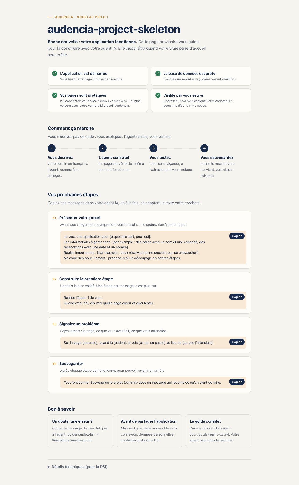

# audencia-project-skeleton

Squelette de projet Audencia : **Symfony 7.4 LTS** servi par **FrankenPHP** (worker mode, Caddy intégré), le tout sous Docker.

Basé sur [dunglas/symfony-docker](https://github.com/dunglas/symfony-docker), adapté pour Audencia.

> **Vous n'êtes pas développeur·se ?** Suivez le guide pas-à-pas
> [Créer une application avec un agent IA](docs/guide-agent-ia.md) : installation, création du projet et prompts à copier-coller.

Conventions de code, base de données, tests et sécurité : [Bonnes pratiques des projets Audencia](docs/bonnes-pratiques.md).



## Stack

| Composant  | Version                                   |
| ---------- | ----------------------------------------- |
| Symfony    | 7.4 LTS (`symfony/*: 7.4.*`)              |
| PHP        | 8.5 (image `dunglas/frankenphp:1-php8.5`) |
| FrankenPHP | 1.x (worker mode, HTTP/2, HTTP/3)         |
| Timezone   | `Europe/Paris`                            |

## Démarrage

```bash
make build   # build des images
make up      # démarre la stack → https://localhost:8443
make sh      # shell dans le conteneur php
make down    # arrête la stack
```

Accepter le certificat TLS auto-signé généré par Caddy au premier accès.

Ports dev par défaut : **8000** (HTTP) et **8443** (HTTPS/HTTP3), pour ne pas entrer en conflit avec un Traefik local sur 80/443.
Pour les changer, les définir dans `.env.local` (non versionné) :

```dotenv
HTTP_PORT=8000
HTTPS_PORT=8443
HTTP3_PORT=8443
```

Docker Compose ne lit pas `.env.local` de lui-même : le `Makefile` le lui passe via `--env-file`. Lancé à la main : `docker compose --env-file .env --env-file .env.local up -d`.

## Page d'accueil

`https://localhost:8443/` affiche une page d'accueil provisoire destinée aux non-développeurs : état de l'application en langage simple (application, base de données, identifiants de connexion locaux), fonctionnement avec un agent IA, messages prêts à copier. Les versions techniques sont dans un bloc repliable « Détails techniques ».
Elle n'existe qu'en `dev` et `test` (`#[When]` sur le service + `env` sur la route). À supprimer dès la première vraie route :
`src/Controller/WelcomeController.php`, `templates/welcome/`, `tests/Functional/WelcomeTest.php`, ainsi que la règle `app_welcome` dans `config/packages/security.yaml` et dans `PUBLIC_ROUTES` de `tests/Functional/Security/AccessControlTest.php`.
C'est la seule page publique : elle n'existe pas en prod.

## Connexion SSO Microsoft

Toutes les pages exigent une connexion, dans tous les environnements :

| Environnement       | Connexion                                                                       |
| ------------------- | ------------------------------------------------------------------------------- |
| `prod` (et qualif…) | SSO Microsoft (Entra ID) : la personne non connectée est envoyée chez Microsoft |
| `dev`               | Formulaire `/connexion`, identifiants **`audencia` / `audencia`**               |
| `test`              | Faux SSO Microsoft (`tests/Double/FakeMicrosoftClient.php`), sans réseau        |

Bundle `knpuniversity/oauth2-client-bundle` + `thenetworg/oauth2-azure`, contrôle du tenant, déconnexion Microsoft incluse.

- Identifiants Entra ID fournis par la DSI, à définir sur le serveur (jamais dans un fichier versionné) : `AZURE_CLIENT_ID`, `AZURE_CLIENT_SECRET`, `AZURE_TENANT_ID`.
- URL de redirection à déclarer : `https://<domaine>/connect/azure/check`.
- Page d'exemple protégée : `https://localhost:8443/mon-compte`.
- Garde-fous : `AccessControlTest` échoue si une route est accessible sans connexion, `ProdLoginTest` si le formulaire de dev existe en prod (`tests/Functional/Security/`).

Détails, configuration Entra ID et RGPD : [docs/sso-microsoft.md](docs/sso-microsoft.md).

## Pages d'erreur

Template unique `templates/bundles/TwigBundle/Exception/error.html.twig`, affiché en prod (`APP_DEBUG=0`) pour tous les codes HTTP,
avec un titre/message en français pour 400, 401, 403, 404, 405, 419, 429, 503 et un message générique pour les autres 5xx.
Le message de l'exception n'est jamais affiché.

- Prévisualiser en dev : `https://localhost:8443/_error/404`, `/_error/500`, etc.
- Page dédiée à un code : créer `error<code>.html.twig` dans le même dossier.

## Base de données

SQLite par défaut (`DATABASE_URL` dans `.env`) : aucun service à installer. Fichiers dans `var/data/app_<env>.db` ; en prod, `var/data` est un volume nommé (`app_data`).
Pour passer à PostgreSQL/MySQL : changer `DATABASE_URL` (exemples commentés dans `.env`) et ajouter le service dans `compose.yaml`.

## Qualité

| Outil        | Config                                                                                         | Commande                  |
| ------------ | ---------------------------------------------------------------------------------------------- | ------------------------- |
| PHP-CS-Fixer | `.php-cs-fixer.dist.php` (règles du projet candidat + `kubawerlos/php-cs-fixer-custom-fixers`) | `make cs` / `make cs-fix` |
| PHPStan      | `phpstan.dist.neon` (level `max`, extensions Symfony, Doctrine, PHPUnit)                       | `make phpstan`            |
| PHPUnit 13   | `phpunit.dist.xml`                                                                             | `make test`               |

`make qa` enchaîne les trois ; la CI GitHub (`.github/workflows/ci.yaml`) les exécute aussi.

## Créer un nouveau projet à partir du skeleton

```bash
git clone https://github.com/AudenciaDTSI/audencia-project-skeleton.git mon-projet
cd mon-projet
bin/init-project mon-projet   # renomme, génère APP_SECRET, réinitialise Git
make build && make up
```

Les agents IA suivent la même procédure, décrite dans [`AGENTS.md`](AGENTS.md) (lu aussi par Claude Code via `CLAUDE.md`).

## Production

```bash
APP_SECRET=$(openssl rand -hex 16) \
SERVER_NAME=mon-app.audencia.com \
docker compose -f compose.yaml -f compose.prod.yaml up -d --build --wait
```

Image prod : rootless (`www-data`), cache Symfony préchauffé, OPcache preload, `validate_timestamps=0`.

## Écarts par rapport à symfony-docker upstream

- **Mercure retiré** (hub Caddy + hot reload FrankenPHP qui en dépend) : la config upstream ne démarre pas avec le module Mercure embarqué dans FrankenPHP 1.13 (`unknown mercure directive "demo"`, puis exigence du mode compatibilité pour `publisher_jwt`). Pour le réintroduire : `composer require symfony/mercure-bundle` et rajouter le bloc `mercure { … }` dans `frankenphp/Caddyfile`.
- Le rechargement du code en dev passe par le mode `watch` du worker FrankenPHP (redémarrage du worker à chaque modification).
- Timezone PHP `Europe/Paris`.
- Nom de projet Compose et images `audencia-project-skeleton-php-{dev,prod}`.

## Docs upstream

1. [Options disponibles](docs/options.md)
2. [Services additionnels (Postgres, …) via Flex](docs/extra-services.md)
3. [Déploiement en production](docs/production.md)
4. [Debug avec Xdebug](docs/xdebug.md)
5. [Certificats TLS](docs/tls.md)
6. [Troubleshooting](docs/troubleshooting.md)
